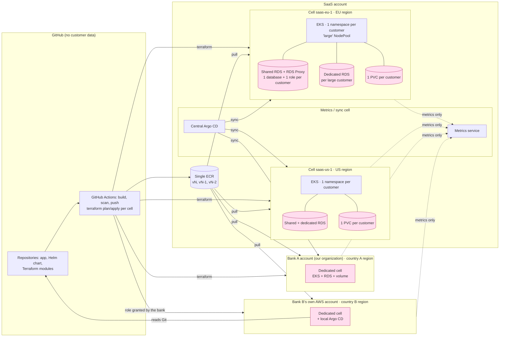

# Part 2: a single-tenant platform built on regional cells

## 1. Assumptions and open questions

### Assumptions

| Assumption | What changes if it is wrong |
|---|---|
| "Own database" means a dedicated PostgreSQL database, not a dedicated server | One RDS per customer: much higher cost, and the provisioning Job disappears |
| "Isolated instance" means a separate process, disk and database; a namespace is enough | A dedicated node or cell per customer: far more to run for a team of two |
| Both banks are in countries that have an AWS region | Local Zone, Outposts or no AWS at all: escalate to product and legal |
| Bank A also wants a dedicated instance in its own account (the brief only states residency) | It becomes a standard customer of an existing cell in its country's region, if there is one |
| No strict SLO: downtime during upgrades and a single-AZ volume are acceptable | Files migrate to S3 to run several replicas across AZs |
| Customers stay at most two versions behind | More channels, and migrations kept compatible for longer |
| A large customer's traffic fits in one pod on one large node | Files migrate to S3, then horizontal scaling |
| Metrics (customer id, volume size, error rates) are not customer data for the banks | The banks' metrics stay in their country, with a local dashboard |
| The existing cluster can be brought into the cell module | A new cell is built next to it, and customers are moved one by one |
| The app can be changed to add versioned migrations | Table creation stays at startup, and rolling back across versions is not safe |
| User authentication is out of scope of the platform | The ALB authenticates users (OIDC, per customer) before forwarding, with no app change |

### Open questions

| Question | Why it matters |
|---|---|
| Bank B's rules on images and access | Pull from our ECR or a registry on its side, scope and audit of our deployment role |
| Who may access bank data, and from where | Data residency says nothing about operator location or nationality |
| RPO and RTO | A daily EBS snapshot means up to 24 h of lost files |
| Security fixes on N-1 and N-2 | Backporting means maintaining three branches |
| Data retention after a customer leaves | Backup retention and effective deletion (GDPR, contracts) |
| Central Argo CD or one per cell | Simpler to run, but an incident hits every cluster |
| Argo CD and metrics: self-hosted or managed | Less to run, but a cost per Application and fewer features |

## 2. Proposed design

A **cell** is a region. It runs a Terraform cell module (VPC, EKS, shared RDS), then the customers' Kubernetes manifests through Argo CD. Each customer gets its own namespace, PVC and database. Adding a small customer touches neither Terraform nor the account; a large customer also adds its dedicated RDS to the cell's Terraform.

### Accounts

| Account | Contents |
|---|---|
| SaaS | The EU and US cells (all standard customers), ECR, the metrics / sync cell (Argo CD and metrics service) |
| One per customer that requires it | Its dedicated cell, in its country's region. Bank A: an account in our organization (assumption). Bank B: its own AWS account. |

The number of accounts grows with explicit requests, not with the number of customers.

### A customer in a cell

- **Instance:** one chart release in namespace `tenant-<id>`: single-replica StatefulSet, PVC, Secret, Ingress on `<id>.filedrop.example`.
- **Exposure:** one ALB shared per cell (Ingress group), not one ALB per customer.
- **Database:** one database and one role per customer.
- **Connections:** RDS Proxy in front of the shared RDS and a `CONNECTION LIMIT` per role, since the app opens one connection per request.

| | Small (≈ 90%) | Large (≈ 10%) |
|---|---|---|
| Database | The cell's shared RDS, Multi-AZ | Dedicated RDS, created by Terraform from the catalog |
| Nodes | Shared `general-purpose` NodePool | Tainted `large` NodePool, one node per customer |
| Disk | Standard gp3 | gp3 with provisioned IOPS and throughput, up to 2 TB |

### Automation

Priority work, in this order:

1. **CI/CD:** image build, scan and push, `terraform plan`/`apply` per cell, scheduled `plan` to detect drift.
2. **Helm chart:** the 15 existing customers are moved to Helm releases deployed by the CI.
3. **Argo CD:** it takes over the same charts. An ApplicationSet reads the catalog. Central Argo CD for our accounts, a local Argo CD in bank B's account.

- **Database provisioning:** a Job in the cell's `platform` namespace (Argo CD PreSync) creates the customer's database and role idempotently, generates its password and writes it to Secrets Manager; External Secrets Operator syncs it into the namespace. Dropping a database stays a manual operation.
- **Channels N, N-1, N-2:** each channel pins an image and chart version. A release shifts the channels in one commit; moving a customer to another channel is a one-line change.
- **Waves:** internal customer first, then small, then large customers, cell by cell, bank B in its maintenance window.
- **Versioned migrations** replace the `CREATE TABLE` at startup (a code change), run by a Job before the rollout.
- **Rule:** a migration is never destructive right away. The new structure is created, the old one is kept and only dropped after at least three releases. A customer can therefore roll back to N-2 without touching its schema.

### Security

- **Data boundary:** content, databases, backups and logs never leave the cell or its region. Only images come in; only metrics go out.
- **Between customers:** NetworkPolicy between namespaces, quotas, Pod Security `restricted`. Large customers also get their own node.
- **TLS:** the ALB terminates TLS: HTTPS only, one wildcard ACM certificate for `*.filedrop.example`.
- **Database:** each role has no access to other databases. The Job's `provisioner` role is limited to `CREATEDB` and `CREATEROLE`.
- **Secrets:** the Job's IAM role is limited to `tenant/*` secrets in Secrets Manager.
- **Banks:** their backups are encrypted with their own KMS key. Bank B grants a scoped role to our CI and runs its own Argo CD.

### Backup and restore

- **AWS Backup per cell**, with no copy outside the region. The banks' backups stay in their account.
- **Database:** RDS can restore a whole instance to any second of the last few days (PITR, *point-in-time recovery*), but not a single database. Large customer: restore its dedicated instance. Small customer: restore the shared instance to a temporary copy, extract its database (`pg_dump`), import it back into the shared RDS, then delete the copy.
- **Files:** daily EBS snapshot, tagged per customer.
- **Consistency:** the database is restored to a point before the volume snapshot. Files are written before their row and never deleted, so every row finds its file.
- **Monthly test:** restore a random customer into a test namespace.

### Metrics

Each cell pushes its metrics to the metrics service. The other accounts can only push metrics, filtered at the source by an allowlist. No customer data leaves the cell.

The metrics service and Argo CD run in a **metrics / sync cell**, apart from the customer cells: if the platform goes down, monitoring keeps running, and the other way around. An outage of this cell still blocks deployments and alerting.

- **Location:** in the SaaS account, with its own VPC and cluster, sharing nothing with the customer cells.
- **Argo CD:** self-hosted or managed by AWS (EKS Capability for Argo CD, billed per managed Application).
- **Metrics:** self-hosted or managed (for example Amazon Managed Service for Prometheus); the tool is not a structural choice.

### Accepted limits

- 1 replica per customer on EBS: downtime on every upgrade or vertical scaling, and losing an AZ stops the customer until restore;
- namespace isolation is not the strongest option (dedicated node or cluster), but it is enough for standard customers;
- a shared RDS means noisy neighbors and shared major upgrades;
- admin access to the SaaS account covers every standard customer in both regions;
- a customer moving from small to large goes through a dump and restore.

### What would change the decision

- a strict SLO, or large customers with heavy concurrent traffic: migration of the files to S3;
- "own database" meaning "own server": one RDS per customer, and a new cost assessment;
- a bank country without an AWS region: escalate to product and legal;
- too many databases to manage with a Job: a database operator;
- an audit requirement to separate tooling from data: the metrics / sync cell in its own account.

## 3. Alternatives considered

| Option | Why it was rejected |
|---|---|
| One EKS cluster per customer | The strongest isolation, but 300 control planes to pay for and upgrade every month with two engineers. Kept for customers that require it, as a dedicated cell. |
| One AWS account per customer | Same cost, plus account vending and cross-account roles for each customer. Only for customers that require it (bank B). |
| One RDS per customer | Per-customer PITR and no noisy neighbors, but 300 instances to pay for and maintain. Kept for large customers. |
| EFS for files | Allows several replicas without a code change, but slow and costly at 2 TB per customer |
| Files in S3 now | The target if an SLO or heavy traffic requires it. It is a migration, not an improvement of the current design: storage code rewritten, every customer's files copied (up to 2 TB), backup and restore redone. Versioned migrations are a small change that keeps the current design. |
| Terraform `postgresql` provider for databases | The CI needs network access to private RDS instances, adding a customer goes through Terraform, and passwords risk ending up in the state |
| CI-only deployments, without Argo CD | Simpler at first, but 300 pushed releases and no drift correction; used only as the first step |
